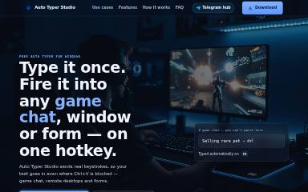

# Text Repeat Utility — Fire Saved Snippets With a Hotkey on Windows

A small Windows helper that types your stored snippets into whichever window has focus. Press a hotkey, the text types itself — character by character — exactly like a physical keyboard. That is why it works in game chat, remote desktop windows, VM consoles, kiosk apps and legacy forms where a normal clipboard paste quietly fails. Free, Windows 10 and 11, no account, no watermark, no ads.

A snippet has a name, a hotkey, and the text to type. You can keep as many as you need side by side.

## Download

**Latest build:** [TextRepeatUtility.zip](../../releases/latest/download/AutoTyperStudio.zip)

The archive is portable. Unzip anywhere, run the app from the folder, delete the folder when you are done. No installer, no admin prompt.

## Features

- **Per-snippet hotkeys** — bind an F-key, a modifier combo, or anything comfortable. One hotkey, one block of text.
- **Real keystrokes** — the OS-level keyboard events land in fields that reject Ctrl+V, including chat clients, RDP sessions and a lot of in-game consoles.
- **Typing speed slider** — 30 to 3000 characters per minute. Slow for an interactive feel, fast when throughput matters.
- **Startup delay** — optional pause after the hotkey fires so you can click into the right field.
- **Unlimited snippet list** — organize by name, scroll through dozens without the UI falling apart.
- **Multi-line aware** — line breaks are preserved, including inside chat clients that otherwise fire on Enter.
- **Portable** — nothing in the registry, no services, no scheduled tasks. The folder is the whole app.
- **Fully offline** — zero telemetry, zero network calls.

## Steps

1. Launch the app from the unzipped folder.
2. Click **Add Snippet**, give it a name, paste the text, bind a hotkey.
3. Click into the destination window — game chat, remote desktop, a form, a terminal.
4. Press the bound hotkey. Watch the snippet type itself in.
5. Tune the typing speed or startup delay if the pace feels off.

## Where it helps

- **Game chat** — long slash-commands, canned messages, trade listings. Even chat windows that block clipboard paste accept typed keystrokes.
- **Remote desktop** — RDP, VNC, VirtualBox and VMware consoles where cross-boundary paste tends to misbehave.
- **Support and sales replies** — the same five canned answers fired dozens of times a day, each on a dedicated hotkey.
- **Form filling** — the same shipping address, phone, email dropped into identical web forms.
- **Code and config snippets** — SQL boilerplate, HTML scaffolding, a shell one-liner you reach for twice an hour.
- **Signatures and templates** — email sign-offs, legal disclaimers, long-form answers reused across threads.

## FAQ

**Is this really free?**
Yes. Free forever, no trial, no locked features, MIT licensed.

**Does it work in games?**
Yes — keystrokes are sent at the operating-system level and are indistinguishable from a physical keyboard in most engines. Some kernel-level anti-cheat still forbids any form of automation; respect each title's rules.

**Does it need admin rights?**
No. It runs as a standard user process.

**Can multiple snippets run on different hotkeys at the same time?**
Yes. Each snippet owns its own hotkey. The ceiling is however many unique key combinations your keyboard can produce.

**Does it need internet?**
No. The app opens directly to its main window and never makes a network call.

## System requirements

- Windows 10 or Windows 11, 64-bit
- A keyboard and a target window

## License

MIT.
